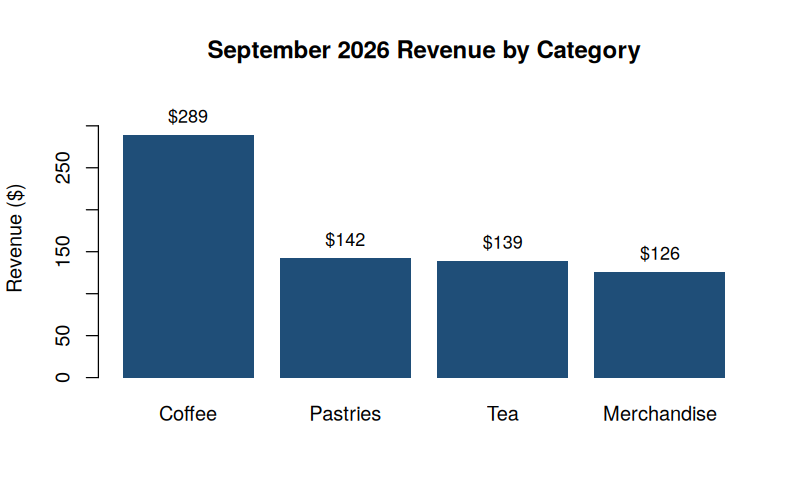

> **AI Assistance Declaration:** I used Claude (Claude Sonnet 5, Anthropic, accessed via claude.ai) on October 12, 2026 for: (1) drafting the README structure and content in Step 1–2, starting from the assignment's Seed/Refinement/Critique prompts; (2) suggesting Markdown formatting and code-chunk layout for `analysis_docs.Rmd` in Step 3. Prompts used: see `Appendix_AIPrompts.md`. I verified outputs using: (a) actually running `scripts/sales_summary.R` in R and confirming every number quoted below (total revenue, category breakdown, top category) matches the script's real console output, not an AI guess; (b) an independent cross-check by re-summing the category revenue column by hand against the script's `total_revenue` figure; (c) a self spot-check previewing this file's rendered Markdown (headers, code blocks, table) before submission. All data, calculations, and the R script itself are my own; the AI's role was limited to drafting and formatting text, not computing any analysis. I am responsible for the accuracy and originality of this work.

# Retail Orders Analyzer

A small R project that summarizes a month of (synthetic) retail orders for a coffee-and-goods shop — total revenue, revenue by product category, and the top-performing category — and produces a chart for a quick read.

## Overview

This project answers one question a small retailer asks every month: **which product category is actually driving revenue?** It reads a CSV of order-level data, computes revenue per category in base R (no external packages required), and writes both a summary table and a bar chart to `output/`.

- **Language:** R (base R only — no `tidyverse` dependency)
- **Input:** `data/retail_orders.csv` (60 synthetic orders, September 2026)
- **Output:** `output/category_summary.csv`, `output/revenue_by_category.png`

## Repository Structure

```
markdown-buddy-nallaparaju/
├── data/
│   ├── generate_data.R        # creates the synthetic dataset (reproducible, set.seed(42))
│   └── retail_orders.csv      # the synthetic dataset itself
├── scripts/
│   └── sales_summary.R        # the analysis script documented in analysis_docs.Rmd
├── output/
│   ├── category_summary.csv   # generated by sales_summary.R
│   └── revenue_by_category.png
├── analysis_docs.Rmd          # R Markdown documentation for sales_summary.R
├── Reflection.md              # reflection on the AI-assisted documentation workflow
├── Appendix_AIPrompts.md      # every AI prompt used and a summary of the response
└── README.md                  # this file
```

## Installation

1. Install R (≥ 4.0) from [r-project.org](https://www.r-project.org/) or via your package manager.
2. Clone this repository:
   ```bash
   git clone https://github.com/<your-username>/markdown-buddy-nallaparaju.git
   cd markdown-buddy-nallaparaju
   ```
3. No external R packages are required — `sales_summary.R` uses only base R (`read.csv`, `aggregate`, `barplot`). To knit `analysis_docs.Rmd` yourself, you'll additionally need the `rmarkdown` and `knitr` packages:
   ```r
   install.packages(c("rmarkdown", "knitr"))
   ```

## Usage

Regenerate the synthetic dataset (optional — a copy is already committed):

```bash
Rscript data/generate_data.R
```

Run the analysis:

```bash
Rscript scripts/sales_summary.R
```

### Example output

```
Total revenue (Sept 2026): $696.87 across 60 orders

Revenue by category:
    category revenue orders avg_order_value
      Coffee  289.29     27           10.71
    Pastries  142.37     17            8.37
         Tea  139.14     12           11.60
 Merchandise  126.07      4           31.52

Top-performing category: Coffee ($289.29)
```



## Example Code

```r
orders <- read.csv("data/retail_orders.csv", stringsAsFactors = FALSE)
orders$line_total <- orders$quantity * orders$unit_price
total_revenue <- sum(orders$line_total)
```

## Documentation

See [`analysis_docs.Rmd`](analysis_docs.Rmd) for a full walkthrough of `sales_summary.R` — purpose, inputs, outputs, and annotated code chunks you can knit yourself.

## License

MIT License — free to use, copy, and adapt for coursework or personal projects.

## AI Assistance Disclosure

- **Tool used:** Claude (Claude Sonnet 5, Anthropic), accessed via claude.ai, October 12, 2026.
- **Main prompts:** the Step 1–3 Seed/Refinement/Critique prompts specified in the assignment brief (full text and the AI's key responses are logged in [`Appendix_AIPrompts.md`](Appendix_AIPrompts.md)).
- **Changes made after review:** rewrote the AI's first README draft to quote the script's *actual* console output (the AI's draft had plausible-looking but invented numbers) once `sales_summary.R` was executed; shortened the Overview section, which the AI's draft had padded with generic praise ("this powerful, flexible tool..."); corrected a code-block language tag the AI left as `bash` on an R snippet.
